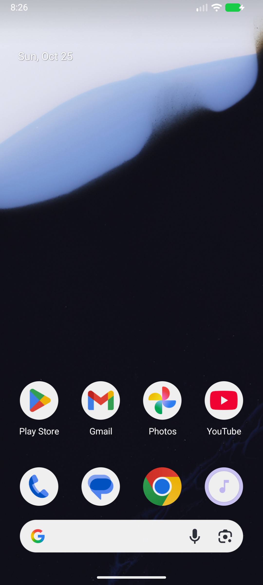
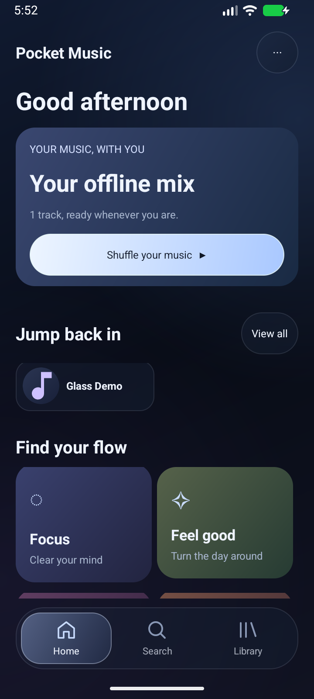
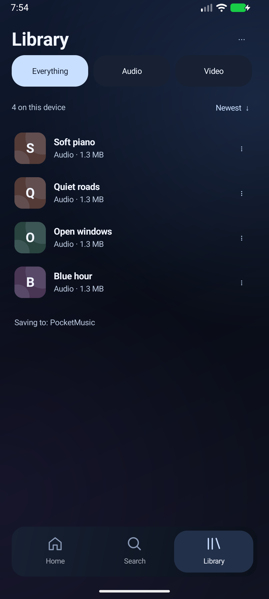
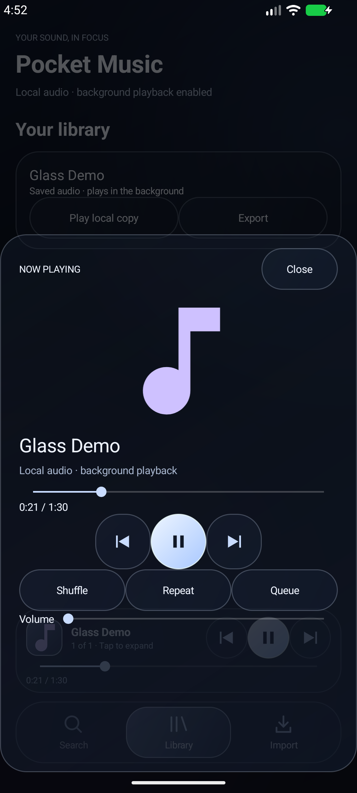

# Pocket Music Android — Replica UI beta

Version **0.4.0-beta.10**, versionCode 17, package com.pocketmusic.android. Android 8+; standalone, with no PC server or required account/API key. This update changes only Android.

## Background online audio in beta 3

Tap a song or **Play** to stream through the native media service, including after Home, app switching and screen-off. Notification/media controls, full player, queue, widget and timer are shared with downloaded playback. Streaming does not save a song; Download stays separate. **Watch YouTube preview (foreground)** keeps the visible video player. See [background-audio behavior and implementation](BACKGROUND-AUDIO.md).

## Refined library and player in beta 2

Library adds local title/artist search, compact filters, storage/track counts, remembered sorting and Play all for the visible audio selection. The saved-audio player is a dedicated full-window screen with focused artwork, separate time labels, queue position and restrained transport. Sound reveals volume; Timer and Queue remain accessible. See [layout and deletion behavior](replica/v0.4-beta2/design.md).

Use a local track’s overflow → **Delete download**. Cancel keeps everything. Confirm removes the app playback copy; an optional unchecked box also deletes its tracked copy in the selected download folder. Other copies/import sources are kept. Deleting the current song stops playback. Online likes remain available; local file history/favorite paths are cleaned.

## Music discovery and UI in v0.4

Home now has an artwork mix, quick picks, liked songs and multiple explained recommendation shelves. Default Songs search and recommendations use the music catalogue instead of the general YouTube video feed. Likes, listening and chosen artists/genres guide recommendations; Not for me offers Undo. Native Material components, recycled shelves, Glide artwork caching and licensed Lucide icons improve consistency. See [behavior and release limitations](MUSIC-DISCOVERY-V04.md), [reused components](THIRD-PARTY-NOTICES.md) and [verification](replica/v0.4/test-plan.md). This remains a beta pending physical-phone validation.

## YouTube connection introduced in beta 4

Open **⋯ → YouTube account → Connect YouTube**, complete Google’s web sign-in, return to YouTube Music, then tap **Use this session**. Downloads use the saved YouTube session automatically. No export/import is needed. Reconnect and Disconnect are in the same menu. This remains an unverified-account beta: Google may reject embedded login, and sign-in does not remove rate limits or guarantee downloads. See [YouTube connection and testing limits](YOUTUBE-CONNECTION.md).

## Install and choose a folder

Use ARM64 for most current phones, or ARMv7 for older 32-bit ARM phones. Install over the previous beta to retain your library. **Do not uninstall first.** Allow notifications for download/background playback controls.

Open the top **⋯ menu → Settings & download folder → Choose / change folder**. Android's system picker asks you to authorize a directory. Choose or create a folder such as Music/Pocket Music or Documents/Pocket Music. Some Android versions restrict selecting storage/Download roots; select a subfolder instead.

Existing saved tracks are copied to that folder when you select it. Future MP3/MP4 downloads save there automatically after conversion. The first download asks for a folder if none is authorized. Folder choice persists across app restarts and updates. Settings also offers **Save existing music to this folder** for retries.

Files in the selected folder remain after uninstall. An app-specific playback copy is retained for reliable offline playback, so there are two copies. Uninstall removes the app-specific copy and preferences. Save existing music to the folder before uninstalling. This build does not automatically scan or import other files already in that folder; use **Import audio** in the top menu.

## Downloads, search, timer and widget

- **↓ Downloads** in the header opens per-track progress, queued/active/completed states, individual Cancel and Retry. Two different videos may download concurrently; same-video formats wait their turn. Jobs interrupted by process death remain available for explicit Retry.
- Search offers local/history suggestions, separate Songs and Videos modes, bounded result caching and cancellation. Music discovery uses on-device taste signals; it does not synchronize a Google account listening history.
- **⋯ → Sleep timer**, or **Timer** in Now Playing, pauses after 15–90 minutes. Cancel it with Turn off. Native saved/online audio handles expiry behind Home; visible video previews remain foreground-only.
- **⋯ → Add home-screen widget** requests Android launcher confirmation. The resizable widget shows saved-music metadata and Previous/Play-Pause/Next. It controls the active native saved/online player; it does not run hidden YouTube playback.
- Native views, bounded executors, event-driven widget updates, static glass styling, cached recommendations, local typeahead and throttled download persistence keep unnecessary work down. No continuous animations, global storage scan or new web UI framework.



## What's changed in beta 3

This pass uses the installed **Replica Recon → Design → Build → Test → Diff** skills. The full local workflow, design tokens, native test plan, bug findings and honest comparison report are under [replica/](replica/parity.md). External reference screenshots are excluded from source/APKs.

- Home starts with small mood chips and playable music rows, followed by actual saved/recent artwork shelves. The large collection banner is removed. No fabricated online recommendations or seeded tracks ship.
- Search has recent queries and Clear, static loading rows, compact preview/download actions, and early validation. A result's text previews it; its ↓ action opens the separate download format dialog.
- Library has Everything/Audio/Video filters and newest/title sorting. Tap the row to play; the overflow holds secondary actions. Next follows the selected title order when starting from a title-sorted library.
- The full player has larger square artwork, original fallback covers, an opaque dark surface, a bigger primary Play/Pause button, and separate shuffle/repeat/queue/volume controls. On compact large-text screens, scroll for lower controls.
- Bounded local played/search history uses existing preferences, without background scanning or catalogue polling. Native media services, chosen-folder saving, official YouTube previews and lightweight rendering remain.

The scope is the core music flow, not a complete Metrolist clone: no account/catalogue sync, social listening, recognition, lyrics or artist pages are added. Raw image-comparison scores are disclosed in replica/parity.md and are low; photo art and test fallback covers are not comparable content. A scoped feature score does not certify visual equivalence or stable physical-device behavior.





## Playback and storage boundaries

Local audio uses Android MediaPlayer/MediaSession with background playback, queue auto-next, shuffle, repeat, seek, volume, notification/media-key controls, audio-focus handling and artwork. Tap the playing title for full controls. File import/export remains available in secondary menus. MP4 can be opened with an external video app after it is saved to the chosen folder.

YouTube previews use the official IFrame API, with a visible 200 × 200 dp Audio player or larger Video player. Switching modes keeps the same player/position/state. Preview pauses outside the foreground; use downloaded/imported audio for background listening. A new search does not replace the active preview queue.

Bundled yt-dlp, QuickJS and FFmpeg handle MP3/MP4 downloads. MP4 prefers up to 720p. The verified bundled nightly engine, daily official update check and one failure-recovery retry are unchanged. See BUNDLED-ENGINE.json. Videos/networks/embedding may be unavailable; Details and Retry report failures.

No analytics, broad storage permissions, background library scans, or additional renderer dependencies. Source remains native Java. Metrolist's Home sections and compact music-navigation patterns were reviewed as design references: https://github.com/MetrolistGroup/Metrolist and its HomeScreen.kt. No Metrolist code/assets were copied or imported.

## Build and verification

Use Android Studio/JDK 17+ (tested JDK 21), Android SDK 36 and Gradle wrapper 9.1.0. Configure sdk.dir in local.properties. Run:

```
gradlew.bat :app:assembleRelease :app:testDebugUnitTest :app:lintRelease
gradlew.bat :app:connectedDebugAndroidTest
```

The SAF instrumentation tests require a directory authorized through the actual system picker; otherwise they skip. Enable liveDownload=true to run network download tests. See TEST-RESULTS.md for results and limits.

Release APKs under app/build/outputs/apk/release are non-debuggable, signed with the **existing local test key**. This remains a beta, not a production/Play Store signing identity. Real ARM phones, long battery sessions and OEM background policies need validation. Keep/back up the signing environment for compatible updates.

## Source and licenses

Pocket Music Android is provided under GPL-3.0; see LICENSE. This directory contains its application source, tests and build scripts. No Metrolist Android code is copied.

- youtubedl-android 0.18.1 (GPL-3.0), including the native dependency build recipes: https://github.com/yausername/youtubedl-android/tree/0.18.1
- yt-dlp: https://github.com/yt-dlp/yt-dlp
- FFmpeg source and license: https://ffmpeg.org/download.html and https://ffmpeg.org/legal.html; Android build recipes: https://github.com/yausername/youtubedl-android/blob/0.18.1/BUILD_FFMPEG.md
- Python: https://www.python.org/downloads/source/ and https://docs.python.org/3/license.html
- QuickJS: https://bellard.org/quickjs/
- AndroidX and Kotlin: Apache-2.0; https://android.googlesource.com/platform/frameworks/support/ and https://github.com/JetBrains/kotlin
- Jackson: Apache-2.0; https://github.com/FasterXML/jackson
- Apache Commons IO: Apache-2.0; https://commons.apache.org/proper/commons-io/

Upstream components retain their original copyrights and licenses. Bundled native binaries are supplied by the pinned youtubedl-android artifacts; refer to that upstream version for its corresponding sources and build scripts.

## Faster online startup (beta 4)

Public audio resolves in-process with NewPipeExtractor, with an authenticated yt-dlp fallback. Media3 starts online playback with 500 ms buffered, then maintains a 3–15 second forward buffer; saved files retain the existing player. Recently resolved sources are reused for up to five minutes in a bounded, account/network-scoped memory cache. No full-song download, audio disk cache, or engine update runs before ordinary playback. See [STARTUP-PERFORMANCE.md](STARTUP-PERFORMANCE.md) for evidence and limits.

## Prepared queue playback (beta 5)

The online engine is reused between songs. While listening on an eligible unmetered connection, Pocket Music prepares one upcoming queue song and attempts a one-second memory preload. Next can consume its resolved source even if optional audio preloading has not completed. Pause, Stop, saved playback, and obsolete queue changes cancel preparation. Battery Saver, metered networks and Data Saver skip it. First uncached plays still require a network lookup. See [Metrolist-inspired scope and references](replica/metrolist/startup-beta5.md) and [startup verification](STARTUP-PERFORMANCE.md).

## Faster first Play tap (beta 6)

On an eligible unmetered connection, visible song results are prepared while you browse: at most two public stream lookups while idle, or one while already playing. The first visible result can hold a short audio prefix and idle player in memory; no playback, media notification, saved song or video starts before Play. Tapping joins pending work and transfers prepared audio to the native service. Leaving results cancels unclaimed work; a tapped song survives Home. Opening a song’s options prepares that selected song too. Metered connections, Data Saver and Battery Saver skip preparation. New/immediately tapped or unprepared results still need network time. See [first-tap measurements and limits](STARTUP-PERFORMANCE.md).

## Smart downloads (beta 7)

Open **More → Smart downloads**, grant download permission, choose limits and enable. Automatically keeps a rotating offline selection from listening history, likes and music recommendations. Off by default; unmetered network, battery and idle-player safeguards apply. See [settings and file safety](SMART-DOWNLOADS.md).

## Account recommendations (beta 8)

Home now loads supported music shelves from your connected YouTube Music account. Connected accounts never fall back to generic search recommendations when a refresh fails. Update, open Home and Refresh; reconnect from More → YouTube account if prompted. Guests still have clearly labeled local suggestions. See [behavior and verification limits](ACCOUNT-RECOMMENDATIONS.md).

## Sign-in recovery (beta 9)

Google account handoff/consent redirects and temporary cross-site login cookies are supported in the isolated login screen. After verification, use **Open YouTube** if loading stalls, then **Save account** once enabled; the page need not finish rendering. Progress/reload controls and unfinished-login restoration are included. Cancelling reconnect keeps your existing encrypted account. See [details and verification limits](LOGIN-RECOVERY.md).

## Validated Music account connection (beta 10)

The login flow now follows the complete-session approach observed in Metrolist: open YouTube Music after Google verification, capture Music context, validate the selected account, atomically save one encrypted bundle and read it back. Connection completes automatically and confirms the verified name. **Choose account**, **Open YouTube Music** and **Retry connection** remain available. The account menu distinguishes old cookie-only sessions from a verified connection. See [implementation, REA evidence and limits](replica/metrolist/login-beta10.md).
